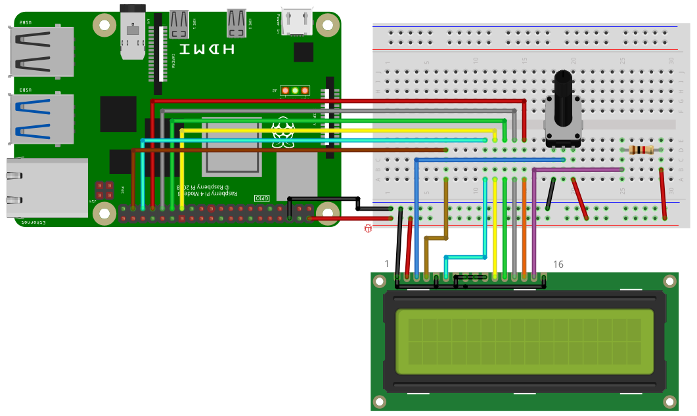

The HD44780 is a text liquid-crystal display usually with 2x16 or 4x16 characters.

## Library

To use the HD44780, import the library `hd44780`

```SmallBASIC
import hd44780
```

## Function Reference

### Open Device

```
OPEN()
OPEN(DB4, DB5, DB6, DB7, E, RS)
OPEN(DB4, DB5, DB6, DB7, E, RS, gpiochip)
```

Opens the HD44780 in 4bit mode using the Pins `DB4` to `DB7` for data, the enable Pin `E` and the RS pin `RS`.

- `DB4` to `DB7`
  - Integer: 0 ... 53
  - GPIO pins on the Raspberry Pi
  - Optional: default values are `DB4 = 0`, `DB5 = 5`, `DB6 = 6`, `DB7 = 13`
- `E`
  - Integer: 0 ... 53
  - GPIO pin on the Raspberry Pi
  - Optional: default value is `19`
- `RS`
  - Integer: 0 ... 53
  - GPIO pin on the Raspberry Pi
  - Optional: default value is `26`
- `gpiochip`
  - String
  - GPIO chip
  - Optional: default value is `/dev/gpiochip0`

### Clear display

```
CLS()
```

Clears the display and sets cursor to 1,1.

### Print string

```
PRINT(s)
```

Prints the string `s`.

- `s`
  - String

Example:

```SamallBASIC
print("Hello World")
```

### Turn off display

```
Off()
```

Turns off the display.

### Turn on display

```
On()
```

Turns on the display

### Close device

```
Close()
```

Closes the HD44780.


## Example

For running this example, you need a HD44780 compatible text display. SmallBASIC
PiGPIO 2 uses GPIO for communication. Please be awarem that some text displays have
an additional I2C module for communication. These display will not work with this
library.

Please wire the display as shown in the following image.



```smallbasic
import hd44780 as LCD

const GPIO_DB4 = 0     ' Pin 27
const GPIO_DB5 = 5     ' Pin 29
const GPIO_DB6 = 6     ' Pin 31
const GPIO_DB7 = 13    ' Pin 33
const GPIO_E   = 19    ' Pin 35
const GPIO_RS  = 26    ' Pin 37

LCD.OPEN(GPIO_DB4, GPIO_DB5, GPIO_DB6, GPIO_DB7, GPIO_E, GPIO_RS)

LCD.CLS()

LCD.PRINT("  Hello  World")
LCD.LOCATE(1,2)
LCD.PRINT("-= SmallBASIC =-")
```
